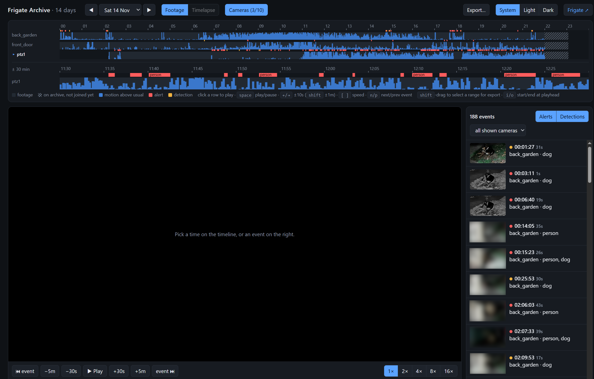

# frigate-archive

An archive for recordings from [Frigate](https://frigate.video) NVR recordings, for long-term off-server archiving to save on disk space, while still keeping recordings easily reviewable and exportable.



Frigate stores recordings on its own disk, and continuous recording from a few cameras fills
a small disk in days. frigate-archive lets you keep only a short window locally (say 12 hours)
and moves everything to an archive filesystem (NFS, SMB, a second disk). There it becomes:

- **one mp4 per camera per hour**, joined without re-encoding, with a sidecar mapping every
  second of the file back to real time, plus Frigate's motion levels and review items
  (alerts and detections, with thumbnails);
- a **review page**: a day timeline per camera, motion graph, alert and detection markers,
  seamless playback across hours at up to 16×, and an event list. It sits behind Frigate's
  own login;
- optional **nightly timelapses**, e.g. a workday in about 6 minutes, where clicking jumps to
  the real footage;
- **clips** from the command line: `frigate-clip garden "2026-10-22 14:00" 45m`.
- **exports** from the page: pick a range and cameras, get one file per camera, optionally
  re-encoded to H.265 to save space.

Everything runs on the Frigate host as two small scripts and a pair of systemd timers, plus an
optional localhost-only export service for the page. There's no database, and nothing about
Frigate itself changes.

---

## Contents

- [How it works](#how-it-works)
- [Requirements](#requirements)
- [Install](#install)
- [Configuration](#configuration)
- [Frigate settings](#frigate-settings)
- [Review page](#review-page)
- [Exports](#exports)
- [Command line](#command-line)
- [Archive layout](#archive-layout)
- [Status and alerting](#status-and-alerting)
- [Operations](#operations)
- [Limitations](#limitations)
- [Versions](#versions)
- [License](#license)

---

## How it works

```
 Frigate host                                         Archive (ARCHIVE, e.g. NFS)
 FRIGATE_MEDIA/recordings/<UTC date>/<HH>/<cam>/MM.SS.mp4     (Frigate's 10-second segments)
        │
        │  every 5 min: frigate-archive (systemd timer)
        │
        ├─ 1. rsync recent segments of hours not yet joined ──▶ recordings/...        raw staging
        │                                                         (small exposure window)
        ├─ 2. frigate-archive-tool consolidate ───────────────▶ hourly/<cam>/<date>/<HH>.mp4
        │       finished hours, newest first, time-boxed;          hourly/<cam>/<date>/<HH>.json
        │       joins from local segments (falls back to staged    thumbs/<cam>/<review-id>.webp
        │       copies), adds motion + review items from the API   (that hour's staging is removed)
        │
        ├─ 3. frigate-archive-tool index ─────────────────────▶ index.json        (+ prune > KEEP_DAYS)
        │
        └─ 4. status ──▶ STATUS_FILE + optional retained MQTT message

 nightly: frigate-timelapse (systemd timer) ──────────────────▶ timelapse/<cam>/<local date>.mp4|.json
```

Some design points:

- **Each byte goes over the network about once.** Finished hours are joined from the local
  copy and written to the archive directly. Raw segments are only staged for the most recent
  hours, so a dead Frigate host only loses a few minutes.
- **Joining never re-encodes**, so it's cheap even for 4K HEVC. When a camera changes codec
  or resolution mid-hour, the hour is split into parts (`HH.mp4`, `HH.p2.mp4`).
- **Gaps are mapped, not filled.** Camera dropouts are simply absent from the joined file.
  The sidecar records each segment's wall-clock start and its offset in the file, which the
  page, clips and timelapses use to stay accurate across gaps.
- **Robust to bad segments.** Segments with corrupt timestamps (common around camera
  reboots) are trimmed to their real length. If ffmpeg chokes on an hour, the segments are
  tested one by one and the bad ones dropped. A join that still fails is marked and skipped,
  not retried forever.
- **Safe against an unmounted archive.** Nothing runs unless the archive contains a
  marker file, so an unmounted mountpoint is never filled.

## Requirements

- **Frigate**, developed against **0.18**. It uses the internal API on port 5000:
  `/api/config`, `/api/<camera>/recordings`, `/api/review`. Versions with the same endpoints
  should work but are untested.
- **Linux with systemd**, running on the Frigate host, with read access to Frigate's media
  directory.
- **python3 ≥ 3.9** (standard library only), plus **ffmpeg / ffprobe**, **rsync**, and
  **flock** (util-linux).
- **docker**, if the API is reached via `docker exec` (the default).
- Optional: **mosquitto_pub** (mosquitto-clients) for MQTT status, and **nginx** with
  `auth_request` for the review page.
- **An archive filesystem** mounted on the host. Rough sizing: what Frigate writes per day ×
  `KEEP_DAYS`. A 2K camera is about 13 GB/day; a 4K HEVC camera about 45 GB/day.

## Install

```bash
git clone https://github.com/SiteRelEnby/frigate-archive.git && cd frigate-archive
sudo ./install.sh                      # installs to /usr/local, creates /etc/frigate-archive/frigate-archive.conf
sudo $EDITOR /etc/frigate-archive/frigate-archive.conf
sudo touch /mnt/frigate-archive/.frigate-archive     # on the mounted archive (your ARCHIVE path)
sudo frigate-archive-tool check
sudo systemctl enable --now frigate-archive.timer frigate-timelapse.timer
sudo systemctl enable --now frigate-archive-export.service   # optional: Export on the review page
```

`install.sh` puts:

| What | Where |
|---|---|
| `frigate-archive`, `frigate-archive-tool`, `frigate-clip` (a link to the tool) | `$PREFIX/bin` |
| The review page | `$PREFIX/share/frigate-archive/www/` (`--www-dir` to change) |
| README, example config, nginx example | `$PREFIX/share/doc/frigate-archive/` |
| systemd units | `/etc/systemd/system/` |
| Config, only if it doesn't exist yet (mode 600) | `/etc/frigate-archive/frigate-archive.conf` |

Options:

| Option | Effect |
|---|---|
| `--prefix DIR` | Install somewhere other than `/usr/local` |
| `--www-dir DIR` | Put the review page somewhere else |
| `--enable` | Also enable and start both timers |
| `--no-systemd` | Skip the units |
| `--uninstall` | Remove everything except your config and the archive |

**Updating:** `git pull && sudo ./install.sh`. It's safe while a sync is running: files are
replaced, not edited in place. Your config is never overwritten. If it's missing settings
that a newer example has, install prints a note and the defaults apply.

**Timezone:** if `TZ` is set in the config, install adds a systemd drop-in so the nightly
timelapse runs at 01:30 *in that zone*, even when the system clock is UTC.

### Without systemd

Nothing depends on systemd: the units only run three plain commands. Install with
`--no-systemd` and schedule them however you like.

| Command | When | Notes |
|---|---|---|
| `frigate-archive` | every 5 minutes | Locks itself (`LOCK_FILE`), so overlapping starts are harmless |
| `frigate-archive-tool timelapse` | nightly, after midnight in `TZ` | Optional; only if `TIMELAPSE_CAMERAS` is set |
| `frigate-archive-tool serve` | always running | Optional (page exports); a foreground process for any supervisor |

`contrib/crontab` (installed as `$PREFIX/share/doc/frigate-archive/crontab.example`) is a
ready `/etc/cron.d` file for the first two. For `serve`, use whatever supervises long-running
processes on your system (OpenRC, runit, s6, supervisord, a container's init). It logs to
stderr and exits cleanly on SIGTERM. Without journald, the scripts' output goes wherever
your scheduler sends it; the cron example appends to `/var/log/frigate-archive.log`.

### Archive mount tips

For NFS, use a **hard** mount with automount, e.g.:

```
nas:/export/frigate-archive  /mnt/frigate-archive  nfs  _netdev,nofail,hard,x-systemd.automount,x-systemd.mount-timeout=30  0 0
```

- **Why `hard`:** a `soft` mount returns I/O errors when the server is slow. With `hard`, an
  outage just stalls the sync until the server is back. Runs can't overlap, and the stall
  shows up as a stale `last_success`.
- **Permissions:** the archive must be writable by root. With root squash or mapall, give the
  export's directory to the mapped user. The scripts will not attempt to run `chown`.

## Configuration

`/etc/frigate-archive/frigate-archive.conf` uses shell-style `KEY=value` lines. Environment
variables with the same names override the base config. Point `FRIGATE_ARCHIVE_CONF` at a
different file to use another config.

| Setting | Default | Meaning |
|---|---|---|
| `ARCHIVE` | `/mnt/frigate-archive` | Archive root. Must contain `.frigate-archive`. |
| `FRIGATE_MEDIA` | `/opt/frigate/data` | Host path of Frigate's `/media/frigate` (has `recordings/`, `clips/`) |
| `FRIGATE_API` | `docker:frigate` | `docker:<container>` (curl inside the container) or `http://host:5000` |
| `KEEP_DAYS` | `14` | Archive retention (footage, timelapses, thumbnails) |
| `RAW_WINDOW_MIN` | `120` | Stage raw segments this recent until their hour is joined |
| `CONSOLIDATE_AFTER_MIN` | `15` | Wait after an hour ends before joining it |
| `CONSOLIDATE_BUDGET_MIN` | `8` | Per run, don't start another hour after this |
| `SETTLE_MIN` | `2` | Skip segments Frigate may still be writing |
| `BWLIMIT` | `30M` | rsync bandwidth cap for staging |
| `TIMELAPSE_CAMERAS` | *(none)* | Cameras that get a nightly timelapse |
| `TIMELAPSE_INTERVAL` / `TIMELAPSE_FPS` | `8` / `30` | One frame per N seconds of footage, at this frame rate |
| `TZ` | *(system)* | Timezone that defines a "day" for timelapses and clip times |
| `STATUS_FILE` | `/var/lib/frigate-archive/status.json` | Status written every run |
| `MQTT_HOST`, `MQTT_PORT`, `MQTT_USER`, `MQTT_TOPIC` | *(off)*, `1883`, –, `frigate/archive/status` | Optional retained MQTT status |
| `MQTT_PASSWORD` / `MQTT_PASSWORD_FILE` / `MQTT_PASSWORD_KEY` | – | Inline; a file holding the password; or `KEY=value` looked up in an env file (e.g. reuse Frigate's `.env`) |
| `EXPORT_LISTEN` | `127.0.0.1:8597` | Where `serve` (the export API) listens. Keep it on localhost. |
| `EXPORT_KEEP_DAYS` | `7` | Delete finished exports after this many days |
| `EXPORT_MAX_HOURS` | `24` | Longest range one export may cover |
| `EXPORT_THREADS` | *(auto)* | x265 thread pool size (`pools=`); set it to leave cores for Frigate |
| `EXPORT_VAAPI_DEVICE` | `/dev/dri/renderD128` | GPU for the *H.265 GPU* option (needs the VA driver on the host; empty = off) |
| `LOCK_FILE`, `TMP_DIR` | `/run/frigate-archive.lock`, `/var/tmp/frigate-archive` | Internals |

`frigate-archive.conf.example` documents each setting in place.

## Frigate settings

frigate-archive doesn't change Frigate's config. Its value comes from pairing it with short
local retention, for example:

```yaml
record:
  enabled: true
  continuous:
    days: 0.5          # 12h of everything locally; the archive has the rest
  motion:
    days: 0.5
  alerts:
    retain:
      days: 30         # only the segments around each alert: cheap, and still reviewable in Frigate
  detections:
    retain:
      days: 14
```

Things to know:

- **Alerts and detections are cheap to keep locally.** Frigate keeps only the few seconds
  around each event, typically a few hundred MB/day for a handful of cameras. Long alert
  retention means you don't have to review within the 12-hour window.
- **Local retention is your recovery window.** If the archive is unreachable for longer than
  Frigate's local retention, footage from that gap is lost. Keep it comfortably above how long
  the archive could plausibly be down, and alert on the status.
- **Before cutting local retention**, run `frigate-archive-tool harvest`. Frigate deletes
  motion data and review items together with footage. Harvest saves them for hours that
  haven't been joined yet, and the join picks them up automatically.

## Review page

The page is one static HTML file with no build step. It reads `index.json`, the hourly
sidecars and the mp4s straight from the archive, and (optionally) talks to the export API.
The nicest way to run it is under Frigate's own URL, e.g. `https://frigate.example/archive/`.

### Features

- **Timeline**, one row per camera for the day:
  - grey where footage exists;
  - blue bars for motion *above that camera's usual level* (cameras with constant background
    motion don't saturate);
  - red and amber markers for alerts and detections;
  - hatched where footage is already on the archive but its hour isn't joined yet (it becomes
    playable about 15 minutes after the hour ends; exports already include it).
  - Click anywhere to play from that moment. A zoom strip shows ±30 minutes around the playhead.
- **Cameras** picker: choose which cameras get a row, remembered per browser. Frigate's
  camera groups appear as one-click presets, and a filter box appears with more than 12
  cameras. Hidden cameras aren't loaded at all, and rows get more compact as the count grows.
- **Player:**
  - continuous across hour boundaries, with the real date and time overlaid;
  - 1–16× speed, ±30 s / ±5 min, previous/next event;
  - a link to download the hour, and a ready-made `frigate-clip` command for the current moment.
- **Events:** thumbnails, labels, sub-labels (e.g. recognized faces) and zones, filterable by
  severity and camera.
- **Timelapse mode:** a clock shows each frame's real time. Click the timeline to seek, and
  *Open footage at this moment* to jump into the real footage.
- **Export** (needs the export API, below): pick a range, select cameras, get one video file
  per camera to download. See [Exports](#exports).

| Key | Action |
|---|---|
| `space` | Play / pause |
| `←` `→` | ±10 s (`shift`: ±1 min) |
| `[` `]` | Slower / faster |
| `n` `p` | Next / previous event |
| `i` `o` | Export range: start / end at the playhead |
| `shift`-drag | Select an export range on the timeline |

**Codecs:** footage plays in its original codec. **HEVC/H.265** plays in Chrome or Edge with
hardware decoding, and in Safari. Firefox can't play it; use the download link. Timelapses
are H.264 and play anywhere.

The most recent hour or so isn't joined yet: the timeline shows it hatched, but it can't play
on the page. Exports include it (from the raw segments), and Frigate's own UI has it.

**Loading:** a day costs one `day.json` per shown camera per UTC day (two per camera for most
local days), not one file per hour. Enable gzip for JSON on the `/archive/data/` route (the
nginx example does); it shrinks these about tenfold.

### Serving it at `<your Frigate URL>/archive/`

Most Frigate installs already have a reverse proxy in front for TLS (nginx, Caddy, Traefik, etc.).
Add a few path routes to it, all checked against **Frigate's own login**, and the archive
sits next to Frigate's UI with no second hostname and no second login:

| Path | Goes to |
|---|---|
| `/archive/` | the page (`$PREFIX/share/frigate-archive/www/`, static) |
| `/archive/data/` | the archive directory (`ARCHIVE`, static, read-only) |
| `/archive/api/` | the export API (`EXPORT_LISTEN`), optional |
| everything else | Frigate, as before |

Each `/archive/` route first makes a subrequest to Frigate's **`/api/profile`** with the
browser's cookies: 2xx means logged in, so serve it; 401 means redirect to Frigate's
`/login`.

- **Same origin:** the browser sends Frigate's `frigate_token` cookie to `/archive/` too, so
  logging in to Frigate logs you in here.
- **Relative URLs:** the page only uses `data/`, `api/` and `../` (the *Frigate ↗* button). Any
  prefix works as long as all three routes share it; the page needs no configuration.
- **The web server serves the video files itself,** with range requests, so seeking in
  hour-long files is instant and nothing extra sits in the data path.

Some considerations:

- **Check auth against the authenticated port (8971),** not the unauthenticated internal
  port 5000. Through 5000 `/api/profile` always succeeds, so everyone gets in.
- **Frigate's 8971 uses a self-signed certificate** by default. Skip verification on that
  hop; it's localhost.
- **After `/login`, Frigate lands on its own home page,** not back on the archive. Open
  `/archive/` again (or bookmark it).
- **Use your front proxy, not the nginx inside Frigate's container:** that one is
  regenerated on every container upgrade.
- **Proxy timeouts and buffering don't matter here:** the routes are static files and small
  JSON requests.

**nginx** (tested; the full block with comments is `contrib/nginx-archive.conf`). This goes
inside the `server { }` that already proxies Frigate:

```nginx
location = /archive { return 301 /archive/; }
location /archive/      { auth_request /_archive_auth; error_page 401 = @archive_login;
                          alias /usr/local/share/frigate-archive/www/; index index.html; }
location /archive/data/ { auth_request /_archive_auth; error_page 401 = @archive_login;
                          alias /mnt/frigate-archive/; }
location /archive/api/  { auth_request /_archive_auth; error_page 401 = @archive_login;
                          proxy_pass http://127.0.0.1:8597/; }
location = /_archive_auth {
    internal;
    proxy_pass https://127.0.0.1:8971/api/profile;
    proxy_ssl_verify off;
    proxy_pass_request_body off;
    proxy_set_header Content-Length "";
}
location @archive_login { return 302 /login; }
```

**Caddy** (an *untested* sketch of the same thing with `forward_auth`; unlike the nginx
version, a logged-out visitor gets Frigate's 401 instead of a redirect to `/login`):

```caddy
frigate.example.com {
    redir /archive /archive/
    handle /archive/* {
        forward_auth https://127.0.0.1:8971 {
            uri /api/profile
            transport http {
                tls_insecure_skip_verify
            }
        }
        handle_path /archive/api/* {
            reverse_proxy 127.0.0.1:8597
        }
        handle_path /archive/data/* {
            root * /mnt/frigate-archive
            file_server
        }
        handle_path /archive/* {
            root * /usr/local/share/frigate-archive/www
            file_server
        }
    }
    handle {
        reverse_proxy https://127.0.0.1:8971 {
            transport http {
                tls_insecure_skip_verify
            }
        }
    }
}
```

**Other proxies** (Traefik ForwardAuth, HAProxy, Apache `mod_auth_request`, ...) need the same
four pieces: the static page, the static archive directory, the optional API proxy, and an
auth subrequest to `/api/profile` on 8971.

A **separate hostname** also works (e.g. `archive.example`), but then Frigate's cookie isn't
sent, so you'd need your own auth there. The same-URL setup avoids that.


## Exports

The page's **Export...** button opens a panel:

1. **Range:** shift-drag across the timeline (any row, or the zoom strip), press `i`/`o` at the
   playhead, or type from/to.
2. **Cameras:** any combination; each gets its own file.
3. **Format:**
   - **Original:** stream copy. Fast (mostly NAS speed), exact quality, same size as the
     recording. If a camera changed codec or resolution inside the range, that camera gets
     extra `....p2.mp4` parts, since a stream copy can't splice them.
   - **H.265 GPU / H.265 CPU:** re-encoded, always one file per camera: every run is
     scaled/padded to one size and audio is normalized (silence added where a run had none).
     Quality *high / balanced / small* = 28 / 30 / 32 (x265 CRF, or VAAPI ICQ for the GPU,
     which land at similar sizes); optional downscale to 1440p–480p.
     - **GPU** (VAAPI `hevc_vaapi`): decode, scale and encode on the GPU, ~13× realtime. Only
       offered when a test encode works (see `EXPORT_VAAPI_DEVICE`). If GPU decoding fails on
       a stream it retries with CPU decoding and GPU encoding.
     - **CPU** (x265 `preset medium`): ~4× realtime at 1440p, slightly better quality for the
       same size.
4. Jobs run **one at a time** in the background with progress, cancel and delete. Finished
   files are in `ARCHIVE/exports/<id>/` and are deleted after `EXPORT_KEEP_DAYS`.

Footage comes from the joined hours, plus raw segments (local first, then staged) for hours
not joined yet, so a range can reach to within a couple of minutes of now. Gaps where a
camera recorded nothing are skipped, not padded.

**What to expect from H.265:** these are re-encodes of footage the camera already compressed,
so savings depend on what you trade. One sample (2304×1296 H.264 at ~1.2 Mbit/s, 15 fps):

| Setting | Size vs original | SSIM | Speed (x265 on 18 cores / Intel iGPU) |
|---|---|---|---|
| CPU CRF 30 | −16% | 0.982 | ~4× realtime |
| CPU CRF 32 | −37% | 0.977 | ~4× |
| GPU ICQ 30 | −19% | 0.981 | ~13× |
| GPU ICQ 32 | −41% | 0.973 | ~13× |
| CPU CRF 30, 1080p | −49% | 0.981 | ~5× |
| GPU ICQ 30, 1080p | −48% | 0.976 | ~13× |
| CPU CRF 28, 720p | −75% | | ~10× |

How much a given setting saves varies a lot with the scene (night noise, foliage, a busy
street), so treat these as a rough guide. Cameras that already record in HEVC gain less.

The service runs at `Nice=15` / `CPUWeight=20`; `EXPORT_THREADS` caps x265 further.
The GPU option will share the GPU with Frigate's decoding and detection; watch Frigate's
GPU stats during long GPU exports. (SVT-AV1 was tried and produced *larger* files on this
kind of footage, so it isn't offered.)

### Export API

`frigate-archive-tool serve` (run by `frigate-archive-export.service`) is a small JSON API on
`EXPORT_LISTEN`. It has **no authentication of its own**: keep it on localhost and proxy it
behind the same `auth_request` as the page (the `/archive/api/` block in
`contrib/nginx-archive.conf`). Without it the page simply hides the Export button.

| Request | Does |
|---|---|
| `GET /exports` | List jobs (newest first), plus `max_hours`, `keep_days` and the available `encoders` |
| `POST /exports` | `{"cameras":[...], "start":epoch, "end":epoch, "encode":"copy"\|"x265"\|"vaapi", "crf":18–40, "height":null\|480...1440}` → queued job |
| `POST /exports/<id>/cancel` | Cancel a queued or running job |
| `DELETE /exports/<id>` | Cancel if needed, then delete the job and its files |

POSTs must be `Content-Type: application/json`, so a cross-site form can't trigger one. Jobs
interrupted by a restart are queued again.

## Command line

```
frigate-archive [-v]                    one sync run (normally the timer does this); -v for details

frigate-archive-tool check              validate config, dependencies, archive and Frigate API
frigate-archive-tool consolidate        join finished hours (time-boxed)
frigate-archive-tool index              rebuild index.json, prune past KEEP_DAYS
frigate-archive-tool harvest            save Frigate metadata for not-yet-joined hours
frigate-archive-tool timelapse [YYYY-MM-DD] [--cams a,b]   default: yesterday, TIMELAPSE_CAMERAS

frigate-archive-tool export --cams a,b --start T (--end T | --duration D) [--x265|--gpu [--crf N] [--height H]]
    one file per camera into ARCHIVE/exports/<id>/ (shows up in the page's job list too);
    T is local "YYYY-MM-DD HH:MM[:SS]", "HH:MM" for today, or @epoch (unambiguous across DST)
frigate-archive-tool serve              the export API (normally frigate-archive-export.service)

frigate-clip <camera> <start> <duration> [out.mp4]
    frigate-clip garden "2026-10-22 14:00" 45m      -> ARCHIVE/clips/garden_20261022_140000_45m.mp4
    frigate-clip garden 07:45 5m                    today, local time
```

- **Clip times** are local (`TZ`). Durations look like `90s`, `45m` or `1h30m`.
- **Clips are cut without re-encoding**, so they snap to keyframes, which are usually
  1–2 s apart.
- **Codec changes:** a range that spans one produces `...p2.mp4` as well.

All tool commands are safe to run by hand while the timers are active. Each process uses its
own scratch directory.

## Archive layout

Dates and hours under `recordings/` and `hourly/` are **UTC**, matching Frigate's own layout.

| Path | Contents |
|---|---|
| `.frigate-archive` | Marker. Nothing runs without it. |
| `recordings/<date>/<HH>/<cam>/MM.SS.mp4` | Raw staging for recent hours |
| `hourly/<cam>/<date>/<HH>.mp4` (`.p2.mp4`, ...) | Joined footage: faststart; HEVC tagged `hvc1` for browsers |
| `hourly/<cam>/<date>/<HH>.json` | Sidecar (below) |
| `hourly/<cam>/<date>/day.json` | That day's sidecars in one file, `{"hours": {"HH": sidecar}}`, for the page |
| `hourly/<cam>/<date>/<HH>.failed` | A join that failed, with the error. Delete it to retry. |
| `thumbs/<cam>/<review-id>.webp` | Review thumbnails |
| `timelapse/<cam>/<local date>.mp4` / `.json` | Timelapse and its frame → wall-clock map |
| `clips/` | `frigate-clip` output |
| `exports/<id>/job.json`, `*.mp4` | Exports (page or `frigate-archive-tool export`), kept `EXPORT_KEEP_DAYS` |
| `.meta/<cam>/<date>/<HH>.json` | Harvested Frigate metadata awaiting a join |
| `index.json` | Per camera: joined hours, timelapse days, `pending` (staged, not joined) ranges; Frigate's camera `groups` |

Sidecar format:

```json
{"camera": "garden", "date": "2026-10-22", "hour": "14", "start": 1792677600,
 "parts": [{"file": "14.mp4", "codec": "hevc", "w": 2560, "h": 1440,
            "segs": [[1792677600.04, 0.0, 10.06, 351, 0], ...]}],
 "review": [{"id": "1792678011.4-ab12cd", "start": 1792678011.4, "end": 1792678030.1,
             "severity": "alert", "objects": ["person"], "sub_labels": [], "zones": ["patio"],
             "thumb": true}]}
```

Each `segs` row is `[wall-clock start (epoch), offset in file (s), duration (s), Frigate
motion, Frigate active objects]`.

## Status and alerting

Every run writes `STATUS_FILE`, and publishes the same JSON as a retained MQTT message if
`MQTT_HOST` is set:

```json
{"state":"ok","message":"synced","time":1792732073,"last_success":1792732073,
 "archive_free_gb":1877,"newest":"2026-10-23/04/garden/55.59.mp4",
 "consolidate":{"consolidated":3,"failed":0}}
```

- **`state`** is `ok` or `error`, with the reason in `message`. Possible errors: marker
  missing, rsync failed, newest segment missing from the archive.
- **`last_success`** is kept across failures. **Alert when it's more than about an hour
  old.** That catches errors and also a dead timer or host, which never publish anything.
- **`consolidate`** shows how the last join step went. Join failures don't fail the sync,
  because the footage is already safe in staging.

Home Assistant example:

```yaml
mqtt:
  sensor:
    - name: Frigate archive last success
      state_topic: frigate/archive/status
      value_template: "{{ value_json.last_success | timestamp_custom('%Y-%m-%dT%H:%M:%S%z') }}"
      device_class: timestamp
# then alert when now() - that sensor > 1 hour
```

## Operations

**Is it healthy?**

```bash
frigate-archive-tool check
cat /var/lib/frigate-archive/status.json
systemctl list-timers 'frigate-*'
journalctl -u frigate-archive -n 50 -o cat
find /mnt/frigate-archive/hourly -name '*.failed'
```

**Archive was unreachable.** Nothing to do if it's back within Frigate's local retention: the
next runs stage and join from local disk. Footage older than local retention at that point
is lost.

**A join failed.** Read `<HH>.failed`, then delete it to retry. A retry can only succeed while
the hour's segments still exist locally or in staging.

**First run with existing footage.** The backlog is joined newest first, a few minutes per
run, so the most recent days become reviewable first. Run `harvest` once first if Frigate's
local retention is short.

**Changing archive retention.** Set `KEEP_DAYS`. Pruning happens on the next run.

**Adding a camera.** Nothing to do: every camera that writes recordings is archived. Add it
to `TIMELAPSE_CAMERAS` if you want timelapses.

## Limitations

- **Single host.** It runs where Frigate's media directory is readable. Remote Frigate
  instances aren't supported yet; see [Roadmap](#roadmap).
- **Recent footage doesn't play on the page.** About the last hour shows as hatched (on the
  archive, not joined yet) and only plays in Frigate's UI. By design: hours are joined when
  they're finished.
- **ffmpeg HEVC crashes.** Some ffmpeg builds' HEVC decoders occasionally crash on certain
  camera streams. Joins work around it by dropping the offending segment, and timelapses by
  falling back to a full decode.
- **Browser codec support** limits HEVC playback on the page; see above.
- **Single-user page.** It's a static page with no per-user state. Anyone who can log in to
  Frigate can see every camera's archive and start exports, whatever their Frigate role or
  camera permissions.

## Versions

The page footer and `frigate-archive-tool --version` show the version. To release, bump
`VERSION` in `bin/frigate-archive-tool` and the footer in `www/index.html` together, commit,
and tag `vX.Y.Z`.

## Roadmap

Ideas and TODOs. Nothing here is promised.

### Run anywhere: split the roles

Today everything runs on the Frigate host. The pipeline already has natural seams, and the
aim is to let each piece run wherever suits you: a NAS, a separate review box, offsite.

| Role | Needs | Today |
|---|---|---|
| **Collector** | Frigate's media dir and API | the staging step of `frigate-archive`, plus `harvest` |
| **Transport** | anything that copies files | rsync to a mounted path |
| **Processor** (join, index, timelapse) | the archive dir and ffmpeg | `consolidate` / `index` / `timelapse`, same host |
| **Viewer** (page, export API) | the archive dir (writable, for exports) | static page and `serve`, behind Frigate's proxy |

**The archive directory is the interface.** If whatever moves the files delivers this, a
processor needs no access to Frigate at all:

- `recordings/<utc-date>/<HH>/<cam>/MM.SS.mp4`: raw segments exactly as Frigate wrote them.
  Deliver complete files only: write to a temporary name and rename, as rsync does.
- `.meta/<cam>/<utc-date>/<HH>.json`: Frigate's metadata for the hour, as `harvest` writes it
  today: `{"recordings": [{"start_time", "duration", "motion", "objects"}], "review": [Frigate
  review items, as returned by /api/review]}`.
- `thumbs/<cam>/<review-id>.webp`: review thumbnails.

TODO:

- [ ] **Processor without Frigate:** join from staged segments plus `.meta` only, when
  `FRIGATE_API` / `FRIGATE_MEDIA` are unset. Mostly there already: consolidate falls back to
  `.meta`, but the collector only writes it during `harvest`.
- [ ] **Collector-only mode:** stage segments, metadata and thumbs, then stop, so the Frigate
  host does no joining at all.
- [ ] **Pluggable transport:** a hook (a command given the file list) so rsync over ssh,
  rclone (S3, B2, …), Syncthing and so on can replace the mounted path. Everything that
  crosses is plain files, so any copier works.
- [ ] **Transport-independent settling:** don't rely on mtimes surviving the copy.
- [ ] **Standalone viewer:** document auth when it isn't behind Frigate's login (basic auth,
  oauth2-proxy, Authelia, Authentik), and make the *Frigate ↗* link configurable or hideable.
- [ ] **Offsite copy:** replicate `hourly/`, `thumbs/`, `timelapse/` and `index.json` (already
  joined, so each byte is written about once) to a second target with its own retention.
- [ ] **Per-user access:** respect Frigate roles and camera permissions (needs a server side,
  not just a static page).

### Without systemd

- [x] Plain commands; cron example (`contrib/crontab`)
- [ ] OpenRC / runit / s6 service files for `serve`
- [ ] `install.sh --cron` to install the cron file
- [ ] Container image (sync, processor and `serve`)

### Page

- [ ] Screenshot/privacy mode: blur thumbnails and video, rename cameras to *camera 1…n*
- [ ] Show footage that's local to Frigate but not on the archive yet
- [ ] Commit hash in the version footer (`install.sh` stamping `git describe`)

## License

[MIT](LICENSE)
